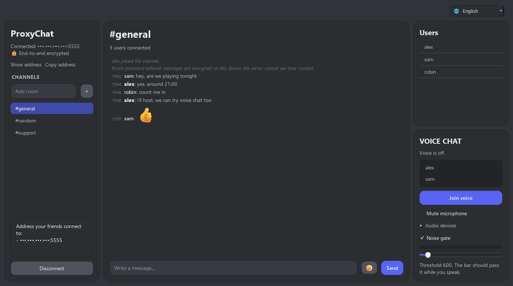

[Türkçe](MANUAL.md) · **English**

# ProxyChat — installation and usage guide

Chat with your friends on your own server. Runs over a virtual network such as
Hamachi or Tailscale, or over a plain local network. No accounts, no email, no
company in the middle.

If a room password is set, messages are **encrypted on the sending device** and
decrypted on the receiving one — not even the person running the server can
read them.



---

## ⚠️ Security statement — read this first

This software **has not been independently audited.** It was written by one
person and its cryptography has not been professionally reviewed.

What it protects:

- ✅ With a room password, message content is end-to-end encrypted; the server
  cannot read it
- ✅ **Forward secrecy** (text 1.9.0, voice 1.10.0): the key is born again every
  session and dropped when the session ends; recorded traffic cannot be opened
  even if the password leaks later

What it does **not** protect:

- ❌ **Metadata is not protected.** Usernames, room names and message
  timestamps travel in the clear. Message **size** has been hidden by padding
  since 1.12.0: the payload is rounded up to buckets starting at 32 bytes, so
  all short messages go out at the same size on the wire (THREAT_MODEL.en.md
  5.7).
- ❌ **No anonymity.** Your IP address is visible to the server you connect to.
- ❌ **No authentication.** Anyone who can reach the server can join rooms.

**No protection against a state-level adversary is claimed.** Do not rely on
this software when lives depend on it; use audited tools such as Signal.

Full and honest breakdown: [THREAT_MODEL.en.md](THREAT_MODEL.en.md)

---

## Why it exists

Platforms keep message records readable on their own servers and can comply
with legal requests. The issue is not a company's intent but its architecture:
if readable data exists, compulsion is possible.

ProxyChat's answer is four things Discord cannot do:

1. **The server is yours.** Nobody can shut it down or change the rules.
2. **End-to-end encryption via a room password.** Not even the operator reads it.
3. **No account.** No email, phone number, verification or data collection.
4. **No internet required.** Works on a local network without leaving it.

Which features are accepted and why:
[apps/proxychat/README.en.md](apps/proxychat/README.en.md)

---

## Installation

**Windows 10/11 (64-bit).** Nothing else needs to be installed — everything,
including Python, is bundled.

Download `ProxyChat-Setup.exe` from the [Releases](../../releases) page and run
it.

> The file is unsigned, so Windows SmartScreen will warn you:
> *More info → Run anyway*. A code-signing certificate costs money, so there
> isn't one yet.

### Running from source

```
python -m venv .venv
.venv\Scripts\activate
pip install -r requirements-dev.txt
python app.py
```

---

## Usage

Three modes on the connection screen:

| Mode | What it does |
| --- | --- |
| **Join** | Connects by IP to a server on another machine. The IP field shows what you type and hides it once you leave the field; hold **Show address** to see it |
| **Host** | Starts the server on this machine. The network to listen on (for example Hamachi) is picked from a list every time (the list names the kind of network, not the address); the address to share is shown in the left panel; it is hidden so it does not leak on a stream — hold **Show address** to see it, **Copy address** copies it without showing it |
| **Demo** | A server reachable only from this computer + fake users, for trying the interface on your own |

**Enter a room password to get encryption.** Everyone in the room must enter the
same password; a user whose password does not match sees a "could not decrypt"
notice instead of the message. If the password is left empty, messages are not
encrypted.

### Voice chat (1.8.0)

Join from the "Voice chat" section in the right sidebar. Everyone in the same
room hears you.

- The audio is encrypted with a key derived from the room session; the server
  relays it without decrypting. In a room without a password the audio is
  unencrypted too. Like text, it **has forward secrecy** (1.10.0): the key is
  born with the session and dies with it.
- **Use headphones.** There is no echo cancellation: what comes out of the
  speakers goes back into the microphone and the other side hears itself.
- Open the panel's **Audio devices** row and pick from the **Microphone** and
  **Speaker** lists (1.12.5); the first option is the Windows default. Since
  it is a one-time setting the row stays closed. The choice is remembered. It
  can be changed during a call: the audio drops for a moment, the call does
  not. If the headset is unplugged during a call it switches to the system
  default, and back when the headset is plugged in again.
- The **noise gate** is on by default: while you are not speaking the
  microphone is silenced, so keystrokes and hiss do not travel. It can be
  turned off.
- **Mute** closes the microphone but does not stop the stream; silence is
  sent instead. Stopping the stream would tell the network who speaks when.
- Audio travels over UDP on the **same port number** as TCP, so the firewall
  asks once.
- If the Opus library (`libopus.dll`) sits next to the program, Opus is used;
  otherwise µ-law. Both sides must use the same codec: the first person to
  join voice sets the room's codec.

### How to share the password

The encryption is only as strong as the way the password is shared: if the
password is read on the way, every conversation can be read.

- **Best: say it in person.** It goes through no server and leaves no record.
- **If you are apart: Signal**, with disappearing messages set to a short time
  (for example 5 minutes).
- **Do not send it over** Discord, Instagram and other social media messages,
  SMS or e-mail. These services keep records and may hand them over on request
  — if the password travels there, the encryption is wasted.
- **Use a strong password.** The **Generate** button next to the password
  field creates a random 6-word password (for example
  `couch-ocean-lake-eagle-snow-coffee` — an example, do not use it). It is
  easy to say and type, and hard to guess. The **Show** button makes the password visible so you can read it
  out.
- If someone leaves the group or you suspect the password leaked, generate a
  new one and share it again.

This is the basic limit of every shared-password system. Exchanging keys
without carrying a password (with a safety number) is ProxyNull's goal; see
[apps/proxynull/README.en.md](apps/proxynull/README.en.md).

The indicator in the top left tells you which state you are in: 🔒 *End-to-end
encrypted* or 🔓 *No room password*.

If the connection drops, it is retried 5 times at 3-second intervals; if that
fails you are returned to the connection screen.

**Interface language:** pick English or Turkish from the 🌐 box in the top
right. The first launch is in English; the choice applies immediately and is
remembered.

---

## How the encryption works

| | |
| --- | --- |
| Key derivation | Argon2id (RFC 9106: 3 passes, 4 lanes, 64 MiB memory), salt = room name |
| Cipher | Fernet (AES-128-CBC + HMAC-SHA256) |
| Library | [`cryptography`](https://cryptography.io) (pyca) 44.0 or later |

**1.7.0 is not compatible with 1.6.x in encrypted rooms.** Key derivation moved
from PBKDF2 to Argon2id, so the same password yields a different key. 1.7.0
shows a message from the older version as "the other side uses a different
ProxyChat version"; 1.6.x shows a new message as "different room password".
Everyone needs to move to the same version. Passwordless rooms are not affected.

The key **never travels over the network**; both sides derive it independently
from the same password. The server chain does not even import `cryptography` —
the server has no *ability* to decrypt, and that is by design.

**Known limitations** are listed in the security statement above and in section
5 of [THREAT_MODEL.en.md](THREAT_MODEL.en.md).

---

## Privacy switches

In the left panel of the connection screen:

- **Keep diagnostic log** — *off by default.* Writing to disk is persistence;
  turn it on only while investigating a problem. Existing log files are deleted
  when it is turned off. Message content, usernames and IP addresses are
  **never** written to the log.
- **Keep room history** — *off by default* (since 1.7.0), effective in Host
  mode only. When on, the server keeps the latest messages of each room in
  memory and sends them in encrypted form to **everyone** who joins the room,
  even without the room password; a weak password can be attacked offline. When
  off, the server keeps no messages in memory. The program itself keeps the
  messages you saw in this session, at most 200 per room, in memory so they come
  back when you return to a room; they are not written to disk and are dropped
  when you disconnect. Messages sent while you are not in a room do not reach
  you. On installations upgraded from an older
  version this box is reset once, because the older version saved the default
  value on every connection.

The room password is not stored by default. If the "remember" box is checked it
is encrypted with Windows DPAPI; decrypting it requires the same Windows
account.

---

## Server limits

| Limit | Value | When exceeded |
| --- | --- | --- |
| Packet size | 64 KiB | Connection is closed |
| Message content (encrypted form) | 8 KiB | The app does not send it; the text stays in the box |
| History sent on joining a room | Last 100 messages that fit in 64 KiB | The oldest messages are left out |
| Message rate | 20 messages per 10 s | Excess is dropped |
| Concurrent clients | 50 | New connections refused |
| Room / user name | 64 characters | Truncated |
| Idle timeout | 120 s | Connection dropped |

Malformed JSON does not kill the session. If a username is already taken in the
room, the server appends a number (`ayse` → `ayse-2`).

---

## Project layout

```
core/               protocol, transport, crypto, server (standard library only)
apps/proxychat/     this application — UI, settings, logging, interface languages (locales/)
apps/proxynull/     encryption-focused sibling product — no code yet; scope
                    and a protocol draft written
tests/              pytest tests
tools/              release tools — the build manifest and the SHA-256
                    checksum list; neither ships with the app. The voice
                    measurement and prototype tools are not published in
                    this repository; the reason is at the top of
                    VOICE_CHAT_PLAN.en.md
docs/               screenshots

THREAT_MODEL.en.md  what is protected, what is not, the order gaps get closed
VOICE_CHAT_PLAN.en.md  the voice chat design — topology, packet format, crypto
CHANGELOG.en.md     what was wrong and what changed, version by version
THIRD-PARTY.en.md   third-party components in the package, licences and sources
VERIFYING.en.md     how to verify a download, and the limit of that check
SECURITY.en.md      reporting a vulnerability
```

To add an interface language, copy `apps/proxychat/locales/en.py`, translate
it, and register it in `apps/proxychat/locales/__init__.py`.
`tests/test_i18n.py` catches missing or extra keys and broken placeholders.

**The server chain** uses no third-party dependencies; `cryptography` lives on the client
side only.

---

## Tests

```
python -m pytest -q
```

---

## Building

```
$env:PROXYCHAT_OPUS_DLL = "C:\path\libopus.dll"   # audio codec; see below
.\build_exe.ps1        # dist\ProxyChat.exe        (PyInstaller)
.\build_installer.ps1  # dist\ProxyChat-Setup.exe  (requires NSIS)
```

**`PROXYCHAT_OPUS_DLL` is required.** Since 1.12.2 libopus is packed inside
the executable, but the DLL is **not kept in the repository**: even with its
provenance verified, we would rather not carry a binary here. If the variable
is unset, `build_exe.ps1` stops — quietly producing an executable without Opus
would drop voice to µ-law where nobody would notice. To build without it
deliberately:

```
.\build_exe.ps1 -Opussuz
```

How the DLL is produced, why each build option is required, and the licence
text are in [THIRD-PARTY.en.md](THIRD-PARTY.en.md).

---

## Reporting a vulnerability

[SECURITY.en.md](SECURITY.en.md)

## License

**Copyright (C) 2026 Anti-furry-cloud**

This project is licensed under the **GNU General Public License v3.0** (or, at
your option, any later version). See [LICENSE](LICENSE) for the full text.

You may use, modify and distribute it. If you distribute a modified version you
must publish its source under GPL-3.0 as well — this is meant to make it harder
for anyone to quietly add a backdoor and ship it.

```
This program is free software: you can redistribute it and/or modify
it under the terms of the GNU General Public License as published by
the Free Software Foundation, either version 3 of the License, or
(at your option) any later version.

This program is distributed in the hope that it will be useful,
but WITHOUT ANY WARRANTY; without even the implied warranty of
MERCHANTABILITY or FITNESS FOR A PARTICULAR PURPOSE.  See the
GNU General Public License for more details.
```

## Note

This project is not affiliated with any proxy or VPN service.

---

## A note on translations

The Turkish `MANUAL.md` is the source of truth. If the two ever disagree, the
Turkish one is correct — please open an issue so this file can be fixed.

Every document is published in both languages, and the naming rule is the same
everywhere: the Turkish file carries the plain name, the English one the same
name with a `.en` suffix — `THREAT_MODEL.md` and `THREAT_MODEL.en.md`. The
language switch sits on the first line of every file.

**The landing page is the one exception.** GitHub renders `README.md` as the
front page of the repository, and for a project about encryption the front page
should be readable by whoever arrives — so that file is English and the Turkish
one is `README.tr.md`. The exception stops there; `.md` means Turkish in every
other document.

This paragraph used to list each translated file by name. The list fell out of
date three times, so it was replaced by the rule.
