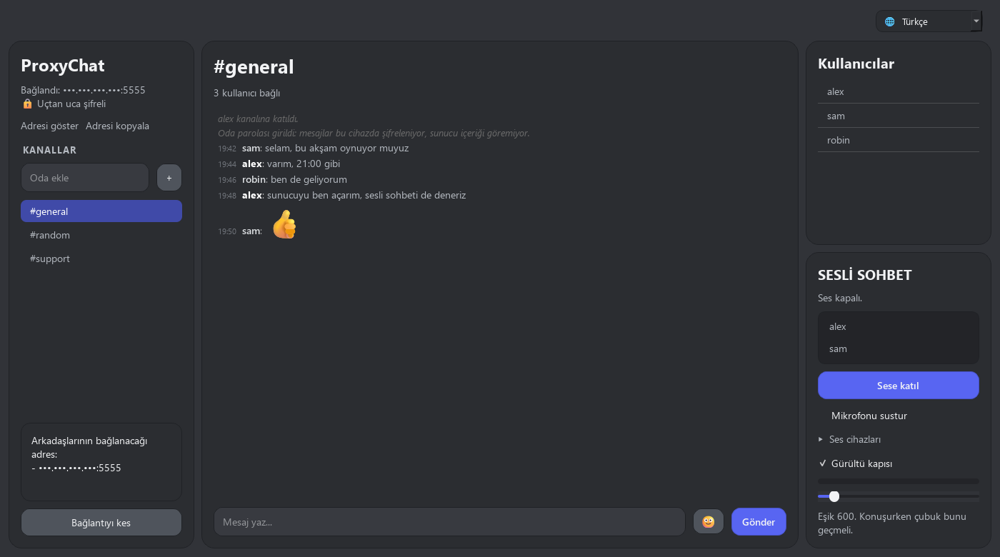

**Türkçe** · [English](MANUAL.en.md)

# ProxyChat — kurulum ve kullanım kılavuzu

Kendi sunucunda, arkadaşlarınla sohbet. Hamachi/Tailscale gibi bir sanal ağ ya
da yerel ağ üzerinden çalışır. Hesap yok, e-posta yok, aracı şirket yok.

Oda parolası girilirse mesajlar **gönderen cihazda şifrelenir** ve alıcı
cihazda çözülür — sunucuyu çalıştıran kişi bile içeriği okuyamaz.



---

## ⚠️ Güvenlik beyanı — önce bunu okuyun

Bu yazılım **bağımsız güvenlik denetiminden geçmemiştir.** Tek kişi tarafından
yazılmıştır ve kriptografisi profesyonel olarak incelenmemiştir.

Sağladığı koruma:

- ✅ Oda parolası girilirse mesaj içeriği uçtan uca şifrelidir; sunucu okuyamaz
- ✅ **İleri gizlilik** (metin 1.9.0, ses 1.10.0): anahtar her oturumda yeniden
  doğar ve oturum kapanınca bırakılır; parola sonradan ele geçse bile
  kaydedilmiş trafik açılamaz

Sağla**ma**dığı korumalar:

- ❌ **Metadata korunmuyor.** Kullanıcı adları, oda adları ve mesaj zamanları
  ağda düz gider. Mesaj **boyu** 1.12.0'dan beri dolguyla gizleniyor: yük 32
  bayttan başlayan kovalara yuvarlanıyor, yani kısa mesajların hepsi telde
  aynı boyda gidiyor (THREAT_MODEL.md 5.7).
- ❌ **Anonimlik yok.** IP adresiniz bağlandığınız sunucuya görünür.
- ❌ **Kimlik doğrulama yok.** Sunucuya erişebilen herkes odalara girebilir.

**Devlet ölçeğinde bir rakibe karşı koruma sağladığı iddia edilmemektedir.**
Hayati önem taşıyan durumlarda bu yazılıma güvenmeyin; Signal gibi denetlenmiş
araçları kullanın.

Ayrıntılı ve dürüst döküm: [THREAT_MODEL.md](THREAT_MODEL.md)

---

## Neden var

Platformlar mesaj kayıtlarını sunucularında okunabilir halde tutuyor ve yasal
taleplere yanıt verebiliyorlar. Mesele şirketin niyeti değil, mimarisi:
okunabilir veri varsa zorlama da mümkün.

ProxyChat'in cevabı, Discord'un yapamayacağı dört şey:

1. **Sunucu sizindir.** Kapatabilecek, kural değiştirebilecek kimse yok.
2. **Oda parolasıyla uçtan uca şifreleme.** Sunucuyu işleten bile okuyamaz.
3. **Hesap yok.** E-posta, telefon, doğrulama, veri toplama yok.
4. **İnternet gerekmez.** Yerel ağda dışarı hiç çıkmadan çalışır.

Hangi özelliğin kabul edildiği ve neden:
[apps/proxychat/README.md](apps/proxychat/README.md)

---

## Kurulum

**Windows 10/11 (64-bit).** Başka hiçbir şey kurmanız gerekmez — Python dahil
her şey pakete gömülüdür.

[Releases](../../releases) sayfasından `ProxyChat-Setup.exe` indirin ve
çalıştırın.

> Dosya imzasız olduğu için Windows SmartScreen uyarısı verir:
> *Ek bilgi → Yine de çalıştır*. Kod imzalama sertifikası ücretli olduğu için
> henüz yok.

### Kaynaktan çalıştırma

```
python -m venv .venv
.venv\Scripts\activate
pip install -r requirements-dev.txt
python app.py
```

---

## Kullanım

Bağlantı ekranındaki üç mod:

| Mod | Ne yapar |
| --- | --- |
| **Join** | Başka bir makinedeki sunucuya IP ile bağlanır. IP alanı yazarken görünür, alandan çıkınca gizlenir; **Adresi göster** basılı tutulunca açılır |
| **Host** | Bu makinede sunucuyu açar. Dinlenecek ağ (örneğin Hamachi) her seferinde listeden seçilir (listede adres yerine ağın türü yazar); paylaşılacak adres sol panelde gösterilir; ekran yayınında sızmasın diye gizli gelir, **Adresi göster** basılı tutulunca görünür, **Adresi kopyala** göstermeden kopyalar |
| **Demo** | Yalnızca bu bilgisayarda açılan sunucu + sahte kullanıcılar; arayüzü tek başına denemek için |

**Şifreleme için oda parolası girin.** Odadaki herkesin aynı parolayı girmesi
gerekir; parolası tutmayan kullanıcı mesaj yerine "çözülemedi" uyarısı görür.
Parola boş bırakılırsa mesajlar şifrelenmez.

### Sesli sohbet (1.8.0)

Sağ kenardaki "Sesli sohbet" bölümünden katılınır. Aynı odadakiler duyar.

- Ses, oda oturumunun anahtarından türeyen anahtarla şifrelenir; sunucu
  çözmeden aktarır. Parolasız odada ses de şifresizdir. Metin gibi **ileri
  gizliliği var** (1.10.0): anahtar oturumla birlikte doğar ve ölür.
- **Kulaklık kullanın.** Yankı bastırma yok: hoparlörden çıkan ses mikrofona
  geri girer ve karşı taraf kendini duyar.
- Cihaz, panelin **Ses cihazları** satırı açılarak **Mikrofon** ve
  **Hoparlör** listelerinden seçilir (1.12.5); ilk seçenek Windows'un
  varsayılanı. Bir kerelik ayar olduğu için satır kapalı durur. Seçim
  saklanır. Görüşme sırasında değiştirilebilir: ses bir an kesilir, görüşme
  kesilmez. Görüşmede kulaklık çıkarılırsa sistem varsayılanına geçilir,
  geri takılınca ona dönülür.
- **Gürültü kapısı** varsayılan açık: konuşmadığınız anlarda mikrofon
  sessizleştirilir, klavye sesi ve cızırtı karşıya gitmez. Kutudan
  kapatılabilir.
- **Sustur** mikrofonu kapatır ama akışı durdurmaz; sessizlik gönderilir.
  Akışın kesilmesi kimin ne zaman konuştuğunu ağa söylerdi.
- Ses, TCP ile **aynı port numarasından** ama UDP olarak gider. Güvenlik
  duvarı izni bir kez istenir.
- Opus kütüphanesi (`libopus.dll`) programın yanındaysa Opus, değilse µ-law
  kullanılır. İki tarafın kodeği aynı olmak zorunda: odanın kodeğini sese
  ilk katılan belirler.

### Parolayı nasıl paylaşmalı

Şifreleme, parolanın ne kadar güvenli paylaşıldığı kadar güçlüdür: parola
yolda okunursa bütün konuşmalar okunur.

- **En iyisi yüz yüze söylemek.** Hiçbir sunucudan geçmez, kayıt bırakmaz.
- **Uzaktaysanız Signal**, kaybolan mesaj süresi kısa (örneğin 5 dakika)
  ayarlanmış olarak.
- **Göndermeyin:** Discord, Instagram ve diğer sosyal ağ mesajları, SMS,
  e-posta. Bu servisler kayıtları saklar ve talep edilirse verebilir — parola
  oradan giderse şifreleme boşa gider.
- **Güçlü parola kullanın.** Parola alanının yanındaki **Üret** düğmesi
  rastgele 6 kelimelik bir parola üretir (örneğin
  `evren-kum-kabak-tepsi-savan-lamba` — örnek, bunu kullanmayın). Söylemesi
  ve yazması kolay, tahmin etmesi zordur. **Göster** düğmesi parolayı okuyabilmeniz için görünür yapar.
- Biri gruptan ayrılırsa ya da parolanın sızdığından şüphelenirseniz yeni
  parola üretip yeniden paylaşın.

Bu, ortak parolalı her sistemin temel sınırıdır. Parola taşımadan anahtar
değiştirme (güvenlik numarası ile) ProxyNull'un hedefidir; bkz.
[apps/proxynull/README.md](apps/proxynull/README.md).

Sol üstteki gösterge hangi durumda olduğunuzu söyler: 🔒 *Uçtan uca şifreli*
ya da 🔓 *Oda parolası yok*.

Bağlantı koparsa 3 saniye arayla 5 kez yeniden denenir; başarısız olursa
bağlantı ekranına dönülür.

**Arayüz dili:** sağ üstteki 🌐 kutusundan İngilizce ya da Türkçe seçilir. İlk
açılışta İngilizcedir; seçim anında uygulanır ve hatırlanır.

---

## Şifreleme nasıl çalışıyor

| | |
| --- | --- |
| Anahtar türetme | Argon2id (RFC 9106: 3 tur, 4 şerit, 64 MiB bellek), tuz = oda adı |
| Şifreleme | Fernet (AES-128-CBC + HMAC-SHA256) |
| Kütüphane | [`cryptography`](https://cryptography.io) (pyca) 44.0 ya da üstü |

**1.7.0, 1.6.x ile şifreli odalarda uyumlu değil.** Anahtar türetme PBKDF2'den
Argon2id'ye geçtiği için aynı parola farklı anahtar verir. 1.7.0, eski sürümden
gelen mesajı "karşı taraf farklı bir ProxyChat sürümü kullanıyor" diye
gösterir; 1.6.x ise yeni mesajı "oda parolası farklı" diye gösterir. Herkesin
aynı sürüme geçmesi gerekir. Parolasız odalar etkilenmez.

Anahtar **hiçbir zaman ağa çıkmaz**; her iki taraf aynı paroladan bağımsız
olarak türetir. Sunucu zincirinde `cryptography` import bile edilmez —
sunucunun çözme *yeteneği* yoktur, olmaması tasarım gereğidir.

**Bilinen sınırları** yukarıdaki güvenlik beyanında ve
[THREAT_MODEL.md](THREAT_MODEL.md) 5. bölümde yazılıdır.

---

## Gizlilik anahtarları

Bağlantı ekranının sol panelinde:

- **Tanılama kaydı tut** — *varsayılan kapalı.* Diske yazmak kalıcılıktır;
  yalnızca sorun araştırırken açın. Kapatıldığında var olan kayıtlar da silinir.
  Loglara mesaj içeriği, kullanıcı adı ve IP **yazılmaz**.
- **Oda geçmişini tut** — *varsayılan kapalı* (1.7.0'dan beri), yalnızca Host
  modunda etkili. Açıksa sunucu oda başına son mesajları bellekte tutar ve odaya
  giren **herkese**, oda parolasını bilmese bile, şifreli hâlde gönderir; zayıf
  bir parola çevrimdışı denenebilir. Kapalıyken sunucu hiçbir mesajı bellekte
  tutmaz. Programın kendisi, başka odaya geçip döndüğünde gösterebilmek için
  bu oturumda gördüğün mesajları oda başına en fazla 200 tane bellekte tutar;
  diske yazılmaz, bağlantı kesilince silinir. Sen odada değilken yazılanlar
  sana ulaşmaz.
  Eski sürümden gelen kurulumlarda bu kutu bir kez sıfırlanır, çünkü eski
  sürüm varsayılan değeri her bağlantıda kaydediyordu.

Oda parolası varsayılan olarak saklanmaz. "Hatırla" kutusu işaretlenirse
Windows DPAPI ile şifrelenip saklanır; çözülmesi aynı Windows hesabını
gerektirir.

---

## Sunucu sınırları

| Sınır | Değer | Aşılınca |
| --- | --- | --- |
| Paket boyutu | 64 KiB | Bağlantı kapatılır |
| Mesaj içeriği (şifrelenmiş hâli) | 8 KiB | Uygulama göndermez, metin kutuda kalır |
| Odaya girene gönderilen geçmiş | Son 100 mesaj, 64 KiB'a sığanlar | En eski mesajlar gönderilmez |
| Mesaj hızı | 10 sn'de 20 mesaj | Fazlası düşürülür |
| Eşzamanlı istemci | 50 | Yeni bağlantı reddedilir |
| Oda / kullanıcı adı | 64 karakter | Kırpılır |
| Boşta kalma | 120 sn | Bağlantı düşürülür |

Bozuk JSON oturumu düşürmez. Aynı odada aynı kullanıcı adı varsa sunucu ada
sayı ekler (`ayse` → `ayse-2`).

---

## Proje yapısı

```
core/               protokol, taşıma, kripto, sunucu (yalnızca standart kütüphane)
apps/proxychat/     bu uygulama — arayüz, ayarlar, log, arayüz dilleri (locales/)
apps/proxynull/     şifreleme odaklı kardeş ürün — henüz kod yok; sınırları
                    ve protokol taslağı yazılı
tests/              pytest testleri
tools/              sürüm araçları — derleme künyesi ve SHA-256 özet
                    listesi; dağıtılan programın parçası değiller. Sesli
                    sohbetin ölçüm ve prototip araçları bu depoda
                    yayınlanmıyor, sebebi VOICE_CHAT_PLAN.md'nin başında
docs/               ekran görüntüleri

THREAT_MODEL.md     neyin korunduğu, neyin korunmadığı, açıkların kapatılma sırası
VOICE_CHAT_PLAN.md  sesli sohbetin tasarımı — topoloji, paket biçimi, şifreleme
CHANGELOG.md        sürüm sürüm neyin yanlış olduğu ve ne değiştiği
THIRD-PARTY.md      pakete giren üçüncü parti bileşenler, lisansları ve kaynakları
VERIFYING.md        indirilen dosya nasıl doğrulanır, ve doğrulamanın sınırı
SECURITY.md         açık bildirimi
```

Yeni bir arayüz dili eklemek için `apps/proxychat/locales/en.py` kopyalanıp
çevrilir ve `apps/proxychat/locales/__init__.py` içine yazılır.
`tests/test_i18n.py` eksik ya da fazla anahtarı ve bozuk yer tutucuları yakalar.

**Sunucu zinciri** üçüncü parti bağımlılık kullanmaz; `cryptography` yalnızca istemci
tarafındadır.

---

## Testler

```
python -m pytest -q
```

---

## Derleme

```
$env:PROXYCHAT_OPUS_DLL = "C:\yol\libopus.dll"   # ses kodeği; aşağıya bak
.\build_exe.ps1        # dist\ProxyChat.exe        (PyInstaller)
.\build_installer.ps1  # dist\ProxyChat-Setup.exe  (NSIS gerekir)
```

**`PROXYCHAT_OPUS_DLL` zorunlu.** libopus 1.12.2'den beri exe'nin içine
gömülüyor, ama DLL **depoda durmuyor**: kaynağı doğrulanmış olsa bile bir
ikiliyi depoda taşımamayı tercih ettik. Değişken ayarlı değilse
`build_exe.ps1` durur — sessizce Opus'suz bir exe üretmek, sesi kimsenin fark
etmeyeceği şekilde µ-law'a düşürürdü. Bilerek Opus'suz derlemek için:

```
.\build_exe.ps1 -Opussuz
```

DLL'in nasıl üretildiği, hangi derleme seçeneğinin neden zorunlu olduğu ve
lisans metni [THIRD-PARTY.md](THIRD-PARTY.md) içinde.

---

## Güvenlik açığı bildirimi

[SECURITY.md](SECURITY.md)

## Lisans

**Copyright (C) 2026 Anti-furry-cloud**

This project is licensed under the **GNU General Public License v3.0** (or, at
your option, any later version). See [LICENSE](LICENSE) for the full text.

Kullanabilir, değiştirebilir ve dağıtabilirsiniz. Değiştirilmiş bir sürümü
dağıtırsanız kaynağını da GPL-3.0 ile yayınlamanız gerekir — bu, birinin
sessizce arka kapı ekleyip dağıtmasını zorlaştırmak içindir.

```
This program is free software: you can redistribute it and/or modify
it under the terms of the GNU General Public License as published by
the Free Software Foundation, either version 3 of the License, or
(at your option) any later version.

This program is distributed in the hope that it will be useful,
but WITHOUT ANY WARRANTY; without even the implied warranty of
MERCHANTABILITY or FITNESS FOR A PARTICULAR PURPOSE.  See the
GNU General Public License for more details.
```

## Not

Bu proje herhangi bir proxy ya da VPN hizmetiyle ilişkili değildir.
